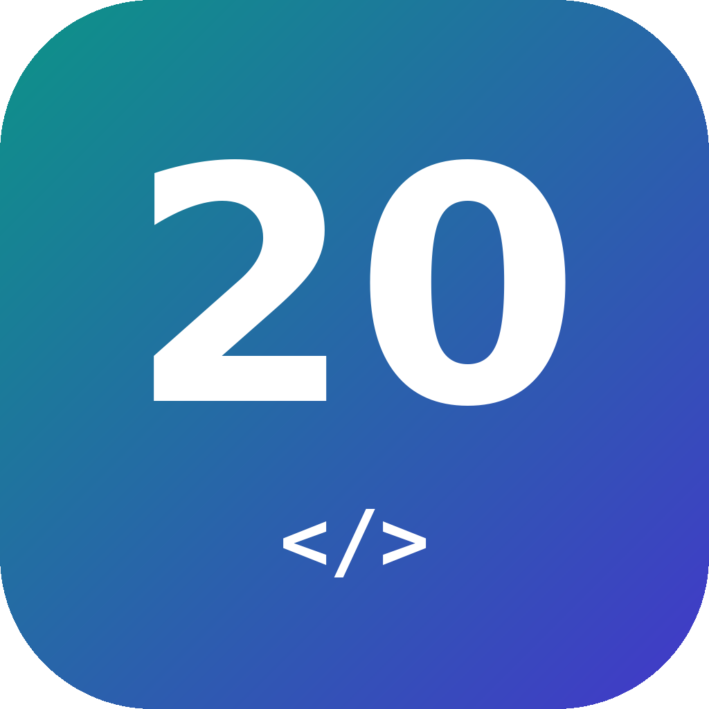

<p align="center"></p>

# odoo20 — Claude Code toolkit for Odoo 20

[](https://github.com/mediafish-agency/odoo20-claude-toolkit/actions/workflows/ci.yml)
[](LICENSE)


Skills and an MCP server that make [Claude Code](https://claude.com/claude-code) write, check, test and port
**Odoo 20.0** code using your Odoo source and a real Odoo runtime, instead of relying on what it remembers
from older versions.

Odoo 20 broke many habits from Odoo 17-19: `ir.model.access.csv` and `ir.rule` are gone (replaced by
`ir.access`), the web client runs OWL 3 (`static props` and `useState` no longer work), server QWeb accepts
only `t-out`, icons are Material Symbols, `get_param` and `read_group(lazy=)` are gone, and XML-RPC gives
way to the JSON-2 API. Language models trained mostly on older code keep producing these older patterns.
This toolkit:

- **teaches** the Odoo 20 APIs layer by layer (Python, XML, CSV, QWeb, JavaScript, SCSS, tests, CLI). Every
  rule cites the Odoo 20 source file it was checked against;
- **looks things up** in your actual source tree (models merged across modules, method override chains, view
  inheritance, access rules, JS registries, asset bundles), including your own and Enterprise addons;
- **validates** every file Claude edits against 91 Odoo 19 -> 20 breaking-change rules, Odoo's own RelaxNG
  schemas and cross-module checks;
- **proves it runs** by installing modules and running their Python and Hoot JS tests on throwaway databases.

## What's inside

| Component | Details |
|---|---|
| **15 skills** (`/odoo20:*`) | `develop` (entry point), `orm`, `http`, `views`, `data-security`, `qweb-reports`, `owl`, `website-pos`, `testing`, `migrate`, `ops`, plus workflow commands `setup`, `new-module`, `validate`, `run-tests`. 63 reference files. [More](docs/skills.md) |
| **Odoo's official skills** | `odoo-guidelines`, `odoo-web-guidelines`, `odoo-review`, `odoo-security`, `odoo-git`, shipped by Odoo in its 20.0 repository and included unchanged |
| **MCP server `odoo20`** | 20 tools: source index and lookups, validator, Odoo's `upgrade_code` run on a copy of your addon, scaffolding, database and test runner, dev server, guarded shell, JSON-2 client. [Tool reference](docs/mcp-tools.md) |
| **Hooks** | After every edit, the file is checked for Odoo 20 breaking patterns and the findings go back to Claude. On first start, the MCP runtime is installed |

## Quick start

**You need:** Claude Code, Linux or macOS (Windows: inside WSL2), Python 3.12+, git, and an Odoo 20.0
source checkout. PostgreSQL 16+ is needed for the tools that install modules and run tests.
Details: [docs/installation.md](docs/installation.md).

**1. In a terminal**, install the plugin. `odoo_root` must be **your** Odoo 20 folder, the one that contains
`odoo-bin`:

```bash
# no Odoo 20 checkout yet? get one:
#   git clone --depth 1 --branch 20.0 https://github.com/odoo/odoo.git ~/src/odoo20

claude plugin marketplace add mediafish-agency/odoo20-claude-toolkit
claude plugin install odoo20@mediafish-odoo --config odoo_root="/path/to/your/odoo20"
```

You can leave out `--config odoo_root=...` when you start Claude Code inside the Odoo folder or next to it:
the tree is then auto-detected.

**2. Start Claude Code** in your Odoo project (`cd /path/to/your/project && claude`) and type this
**at the Claude prompt** (it is a Claude Code command, not a shell command):

```
/odoo20:setup
```

It installs the MCP runtime and builds the source index. It also checks or creates a Python environment
that runs Odoo 20, checks PostgreSQL, saves the plugin options, and creates the test template database.
When it finishes, `/mcp` lists `plugin:odoo20:odoo20` as connected.

Inside Claude Code you can also install from the `/plugin` menu: add the marketplace
`mediafish-agency/odoo20-claude-toolkit`, then install `odoo20`.

## Try it

```text
Which modules override sale.order.action_confirm, in which order, and do they call super()?
Add a "loan duration" computed field to library.loan, show it in the list and form views, and test it.
Port the addon ~/addons/my_module from Odoo 19 to Odoo 20.
Write the ir.access rules so users only see their own loans, managers see everything in their companies.
Create an OWL field widget that shows a star rating for an Integer field, with a Hoot test.
/odoo20:validate ~/addons/my_module
/odoo20:run-tests my_module
```

## Documentation

| Guide | |
|---|---|
| [Installation](docs/installation.md) | Requirements, install, first-run setup, team setup, updating, uninstalling |
| [Configuration](docs/configuration.md) | Every plugin option, Enterprise/custom addons, PostgreSQL connection, data folder |
| [Skills](docs/skills.md) | What each skill covers and when it is used |
| [MCP tools](docs/mcp-tools.md) | All 20 tools with their parameters (generated from the server) |
| [Validator rules](skills/develop/references/version-traps.md) | The Odoo 19 -> 20 breaking changes the validator catches, with fixes |
| [Safety model](docs/safety.md) | What the tools may touch and how writes are gated |
| [Other MCP clients](docs/standalone-mcp.md) | Use the MCP server without the plugin (Claude Desktop, Cursor, VS Code, ...) |
| [Troubleshooting](docs/troubleshooting.md) | Common problems and fixes |
| [Development](docs/development.md) | Repository layout, tests, adding rules and skills, releasing |

## Safety in one paragraph

The tools never write inside your Odoo source tree. They only create, test, upgrade or drop databases whose
names match an allowlist (default `odoo20_*`), so your other databases are never touched. Shell sessions
roll back unless you enable `allow_writes` *and* ask for a commit. Calls to a live server may read freely;
writes need `allow_writes`. Every tool that can change something is marked destructive, so Claude Code asks
before running it. Dev servers bind to 127.0.0.1 and secrets are never printed. [Details](docs/safety.md).

## Compatibility

- **Odoo**: 20.0 Community. Enterprise and any other addons are supported through `extra_addons_paths`.
  Tested against the public `20.0` branch (commits `c8a62e5f` and `6144a016`, November 2026). The toolkit
  is not meant for Odoo 19 or older, except for porting code from them.
- **Claude Code**: plugins with `userConfig` (tested with 2.1.311).
- **OS**: Linux, macOS; Windows through WSL2.

## Contributing

Issues and pull requests are welcome. See [CONTRIBUTING.md](CONTRIBUTING.md), and
[SECURITY.md](SECURITY.md) for vulnerability reports.

## License

[LGPL-3.0](LICENSE), like Odoo Community. Odoo's official skills and the references generated from Odoo's
source are Copyright Odoo S.A. (see [NOTICE.md](NOTICE.md)).

Odoo is a trademark of Odoo S.A. This is an independent community project by
[mediafish](https://www.mediafish.agency), not affiliated with or endorsed by Odoo S.A. or Anthropic.
